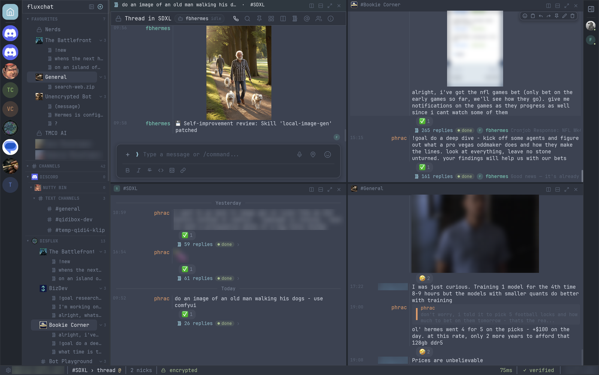

# fluxchat

**The chat client for people who talk to humans *and* run AI agents.**

fluxchat is a fast, native [Matrix](https://matrix.org) client written entirely in Rust. It has a keyboard-first, IRC-inspired interface, tmux-style panes, and first-class controls for AI agents. You can see what your agents are doing, steer or stop them mid-run, and approve what they ask for, all in end-to-end encrypted rooms on a server you choose.



**[Read the user manual →](docs/README.md)**

## Why fluxchat

- **Your agents, on your terms.** Matrix is an open, federated protocol. Run your own homeserver, keep your rooms end-to-end encrypted, and talk to any agent that speaks Matrix. You're not locked into one vendor's chat app or one model. fluxchat encrypts its local data too, with the key in your system keychain.
- **Built to watch many things at once.** Split the screen into panes and windows, tmux-style: a room, its agent's thread, a second agent, a team channel. Drag rooms into place and the layout comes back after a restart.
- **Native, fast, and light enough to leave open all day.** Pure Rust, GPU-rendered with [Iced](https://iced.rs) on [matrix-rust-sdk](https://github.com/matrix-org/matrix-rust-sdk). No Electron, no WebView, no JavaScript. Virtualized timeline and sliding sync, so big rooms stay quick.
- **IRC feel, keyboard-first.** Timestamp, colored nick and message columns in a monospace layout. A command palette, 57+ slash commands with Tab completion, tmux keys and room hotkeys.
- **A complete Matrix client.** Threads, spaces, encryption and verification, voice calls, media and polls. Room admin and moderation, push rules, themes. It's not a demo built around one feature.

## Built for running AI agents

Agent frameworks increasingly use chat as their front end, and Matrix is a good fit. It's encrypted and self-hostable, threads map neatly onto agent sessions, it works on every device, and bots are first-class users. But ordinary chat clients treat an agent like any other person: its progress floods the timeline, approvals are emoji you have to decode, and stopping a runaway run means remembering the right incantation.

fluxchat reads what agents are doing and gives you controls for it. Mark a user as an AI agent, pick its harness, and:

**See what it's doing**
- An **agent chip** in the room header: idle, *working · 3m* with a progress bar, or *waiting on you*, plus its model, context use and cost.
- The **current step** ("📖 Reading notes.md"), a step count and the time so far; a filled progress bar when the agent says how far along it is.
- **Run state** on every request and thread (working / needs you / done / failed), with dots in the room list and **2 running · 1 waiting** in the status bar.
- A **task board**: an agent room's threads as runs, active ones first.
- **Several agents in one room**, each with its own state, and hand-offs between them you can follow.
- **Run history**: duration, model and cost per run, searchable, exportable as a transcript.
- **All your runs** across rooms in one dialog, and a **watch window** that tiles active runs and adds new ones as they start.

**Stay in control**
- **Stop** a run from the run bar, the header menu, or the notification.
- **Review what it changes:** a coding agent's diff opens as files with numbered, coloured lines; approve or request changes.
- **Steer** it mid-run or **queue** the next task, instead of interrupting.
- **Approvals, pickers and questions as buttons**, with a desktop notification when an agent is blocked on you.
- **Get told when a run finishes**: automatically for long runs, or with the 🔔 for any run.

**Work with it like a terminal**
- The agent's **`/commands` autocomplete** and are sent the way its harness expects; skills pass straight through.
- **Ctrl+R** searches what you've sent; **`/snippet`** saves prompts you reuse.
- **Each request opens its own thread** beside the room as the agent starts it.
- Long answers and step logs fold; code blocks copy in one click; diffs are highlighted; PDFs preview.
- **Hold the mic to talk**: a voice prompt, sent on release, into the thread you're in.

**Pluggable harnesses.** Agent frameworks differ in the details: command prefixes, status reactions, how they ask for approval. Each is a small TOML [harness profile](docs/agents.md#harness-profiles). [Hermes Agent](https://github.com/NousResearch/hermes-agent), [OpenClaw](https://github.com/openclaw/openclaw) and Claude Code (through a [Matrix channel](https://github.com/zekker6/claude-code-channel-matrix)) are built in, and adding another (pi, a CI bot, your own) is a new file, no rebuild. Agents you write yourself can skip the guessing entirely: the open [agent protocol](docs/agent-protocol.md) is a few fields in their messages that say exactly what they're doing.

**Matrix first.** fluxchat speaks Matrix, and only Matrix: one open, encrypted, self-hostable protocol, with bridges to most other networks. Want fluxchat on another platform? Have your agent build it and send us a pull request.

See [AI agents](docs/agents.md) in the manual.

### Where it's going

We think the chat client is becoming the cockpit for agents. Where things stand:

- **The protocol, upstream.** Emitters for [Python and TypeScript](sdk) are here; a [Hermes Agent patch](integrations/hermes) is ready to propose, and a [Matrix spec proposal](docs/msc/agent-status.md) is drafted. Next: send them, publish the emitters to PyPI / npm, report progress from Hermes's gateway too, and an OpenClaw plugin, so run state stops being inferred anywhere.
- **Teams of agents.** Rooms with several agents work today (per-agent state, who you're talking to, hand-offs). Next: sending one task to several agents and comparing their answers side by side.
- **Budgets.** Cost per run is recorded; next is a spend limit per agent with a warning before it's reached.
- **Search inside runs.** History searches titles, rooms and agents; next is full-text search across transcripts.

Ideas and pull requests are welcome.

## Screenshots

| | | |
|---|---|---|
|  |  |  |
| Timeline: link previews, replies, inline media | Light theme, threads sidebar and hover preview | Panes: a room and its thread side by side |
|  |  |  |
| Gallery of every image, video and file | Command palette (Ctrl/⌘+K) | Themes, fonts and text size |

## Features

### AI agents
- Mark a user as an AI agent and pick its harness: Hermes Agent, OpenClaw, Claude Code (Matrix channel), generic, or your own TOML profile
- Its `/commands` autocomplete and go out as its harness expects (`!stop`, `/stop`, with a mention where needed)
- Run state on each request and thread (working / needs you / done / failed), from the open agent protocol or the harness's reactions and typing
- Agent chip in the room header with model, context and cost, and quick commands (Stop, Status, Usage, Model, New session…)
- Run bar: time so far, current step, progress bar, Stop, Send / Steer / Queue, and 🔔 tell me when it's done
- Task board in agent rooms; Runs dialog across rooms; a watch window that tiles active runs and follows new ones
- Approvals, pickers and text questions (Hermes's clarify) as buttons; notifications when an agent waits on you or a long run finishes
- New agent threads open beside the room as they start; for agents that answer in threads (Hermes), as soon as they pick up your message, with the run bar and Stop in that thread
- Step logs and long answers folded; runtime footers moved to the chip and status bar
- Prompt history (Ctrl+R) and snippets (`/snippet`), kept encrypted
- Rooms with several agents: a chip each, who you're talking to, hand-offs you can follow
- Review an agent's diff (code block or `.patch`): files, numbered coloured lines, approve or request changes
- Run history with duration, model and cost; search; export a run as a Markdown transcript
- Answer approvals or stop a run from the desktop notification (Linux, macOS)
- Spots agents you haven't marked and suggests the right harness

### Messaging
- Markdown, code blocks with syntax highlighting and a copy button, highlighted diffs, inline LaTeX
- Replies, edits, deletions, reactions, forwarding, pins
- Mentions with autocomplete, `:emoji:` shortcodes, full emoji picker
- Images, video, voice messages (hold to talk), files with PDF previews, GIFs, stickers, polls, locations
- Captions: attach a file and type a message, sent together as one
- Gallery of every image, video and file in a room or thread, back to its first message (encrypted rooms included)
- Link previews, read receipts, typing indicators, per-room drafts
- Rooms open at your first unread message, marked by a NEW line

### Threads
- Threads open in a pane beside the room, with their own reply box; right-click a thread to open it to the right, below, in place or in a new window
- Threads sidebar: every thread in the room, most recently active first
- The three latest threads of each room listed under it in the room list (collapsible); right-click a room for its recent threads
- Hover any thread for the full first message and latest reply
- Reply counts and latest-reply previews under each thread root
- Live updates, including bots that answer inside threads

### Panes & windows
- Split the main area side by side or stacked, as often as you like; put any room or thread in any pane — drag it from the room list onto a pane edge, middle-click / ⌘-click it, or right-click → Open to the right / below / in new window
- Drag to resize and rearrange, zoom a pane to full size
- Multiple windows (layouts), listed in the status bar
- tmux keys: Ctrl+B then `%` `"` `x` `z` `o` arrows `c` `n` `p` `0`–`9` `&`
- Layout saved and restored on restart

### Rooms & spaces
- Room list grouped by space, favourites, unread and mention badges
- Command palette (Ctrl/Cmd+K): jump to rooms or run actions (`>` for actions only)
- Alt+1–9 and Alt+Up/Down room hotkeys
- Space management: browse, join, add, remove and create rooms; edit the space
- Room settings: name, topic, icon, notifications, spaces
- Join requests (ask to join): approve, deny, or deny and ban from a live bar above the room
- Accept or decline all invites at once
- Security & privacy: who can join, history visibility, guests, directory listing, encryption
- Roles & permissions: role per action, privileged users, bans
- Advanced: room version and upgrade, links to replaced/replacing rooms, addresses (main, published, local)
- Bridges tab for bridged rooms: service, network, channel, bot
- Space visibility (private / ask to join / public, directory) and addresses
- Public room directory

### People
- Profile cards with presence, status, roles, verification, and moderation tools
- Member list with filter and presence
- Ignore users (synced to your account, list in Settings), direct messages
- Media previews: always / private rooms only / never, click to show; shared with Element

### Encryption
- End-to-end encryption, emoji (SAS) verification, cross-signing
- Key backup and recovery, session management
- Explanations for messages that can't be decrypted
- Local data encrypted, with the key and sign-in in the system keychain (macOS Keychain, Windows Credential Manager, Secret Service)

### Calls
- Voice calls over MatrixRTC + LiveKit
- Choose microphone and speaker, mic test, echo cancellation, noise suppression

### Notifications
- Desktop notifications driven by your server's push rules
- Account-wide rules: DMs, group rooms, mentions, @room, keywords, invites, calls, bots
- Per-room mode: all messages, mentions only, or mute
- Mentions and keywords highlighted in the timeline
- Mentions inbox (Ctrl/Cmd+I): every message that mentioned you, across all rooms

### Customization
- 9 built-in themes plus your own TOML themes (light and dark)
- Message and sidebar fonts, text size
- Preferences for timestamps (12/24h), compact layout, message grouping, big emoji, link previews, GIF autoplay, send shortcut, markdown, privacy (read receipts, typing, presence)
- Resizable room list, panes and sidebars (pins, threads, mentions, members); hide the room and member lists for more room (Ctrl/Cmd+[ and ])

### Power users
- 57+ slash commands with Tab completion (`/help` lists them)
- `/devtools`: room state inspector and raw event sender
- Password and SSO/OIDC login

## Documentation

The [user manual](docs/README.md) covers everything:

- [Getting started](docs/getting-started.md) · [The interface](docs/interface.md) · [Messaging](docs/messaging.md) · [Threads](docs/threads.md) · [AI agents](docs/agents.md) · [Agent protocol](docs/agent-protocol.md)
- [Panes and windows](docs/panes-and-windows.md) · [Rooms and spaces](docs/rooms-and-spaces.md) · [People](docs/people.md)
- [Notifications](docs/notifications.md) · [Voice and video](docs/calls.md) · [Settings](docs/settings.md) · [Encryption](docs/encryption.md)
- [Keyboard shortcuts](docs/keyboard-shortcuts.md) · [Slash commands](docs/slash-commands.md) · [Themes](docs/themes.md) · [Troubleshooting](docs/troubleshooting.md)

## Building

Requirements: Rust 1.93+, a GPU (wgpu), GStreamer (video). On Linux also libopus and PulseAudio/PipeWire headers (voice).

```bash
# macOS
brew install gstreamer
cargo run -p fluxchat
```

**macOS app bundle**

```bash
scripts/macos-signing-cert.sh   # once: a local code-signing identity
./build-macos.sh
cp -r target/release/FluxChat.app /Applications/
```

macOS ties Keychain access (your saved session) and the microphone permission to the app's signature. The one-time script creates a self-signed "FluxChat Local" identity, which `build-macos.sh` and `cargo run` use when present, so the signature stays the same across rebuilds. Without it builds are signed ad-hoc, and macOS asks again after every rebuild.

**Linux**

```bash
cargo build -p fluxchat --release   # binary: target/release/fluxchat
```

## Architecture

```
crates/
  core/   Matrix logic: timelines, spaces, room admin, push rules, media, audio
  app/    Iced desktop UI (Elm architecture: Message -> update() -> view())
```

| Component | Library |
|-----------|---------|
| UI | Iced 0.14 (wgpu) |
| Matrix | matrix-rust-sdk 0.18, matrix-sdk-ui 0.18 (sliding sync) |
| Encryption | vodozemac |
| Calls | LiveKit 0.7 (MatrixRTC), cpal 0.15 |
| Voice messages | opus + ogg |
| Video | iced_video_player 0.6 (GStreamer) |
| Storage | rusqlite + matrix-sdk SQLite |
| Syntax highlighting | syntect |
| PDF previews | hayro (pure Rust) |

## License

MIT
