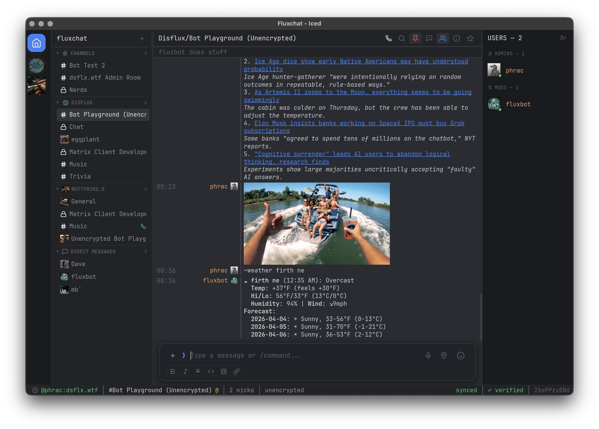

# fluxchat

A Matrix chat client built entirely in Rust. Native GPU-rendered desktop app with an IRC-inspired interface.



## Why fluxchat

- **Pure Rust** -- no JavaScript, no Electron, no WebView. Native GPU rendering via wgpu.
- **IRC meets modern chat** -- right-aligned colored nicks, monospace layout, but with inline images, reactions, threads, encryption, and voice calls.
- **Fast** -- native binary, GPU-accelerated UI, lazy-loaded member lists, no per-frame overhead.

## Features

- **Messaging** -- real-time via Matrix Timeline API with local echo, markdown formatting (bold, italic, strike, code, headings), inline images with lightbox, editing, deletion, forwarding, replies with context, mention pills, reactions, URL previews, read receipts, cross-message text selection with Ctrl+C copy, `//` escape for sending literal `/commands` to rooms
- **Encryption** -- E2EE via vodozemac, SAS emoji verification, manual user verification (for bots), key backup/recovery, cross-signing, session management
- **Voice calls** -- MatrixRTC + LiveKit SFU, mic capture via cpal, in-call panel with participant tiles, PIP widget, mute/hangup
- **Voice messages** -- record with mic button, Opus/OGG encoding, auto-normalization, preview before send, playback with progress bar
- **Video** -- inline video player via GStreamer (iced_video_player), auto-generated thumbnails with rotation detection for bridged media, play/pause/seek controls
- **Threads** -- indicators with reply counts, dedicated thread view, thread entries in sidebar
- **Rooms & spaces** -- grouped room list with indented space hierarchy, Ctrl+K quick room switcher, room creation, settings, invitations, gold star favourites, notifications (all/mentions/mute), aliases, space details modal, right-click context menus, persistent collapsed sections, unread dot + badge indicators
- **Search** -- server-side with client-side fallback, overlay with arrow key navigation, scroll-to-highlight
- **Polls** -- create/vote/end with progress bars (MSC3381)
- **Files & media** -- upload via button/drag-drop/paste, thumbnails, GIF search via Giphy (50MB download limit), stickers, location sharing, file download cards
- **Themes** -- 9 built-in themes (FluxChat, Nord, Nord Light, Dracula, Night Owl, Tokyo Night, Atom One Dark, Catppuccin Mocha/Latte), custom TOML theme files, light/dark mode, theme-aware code blocks (code_bg/code_text)
- **Fonts** -- separate message and sidebar font selection from system fonts
- **Code highlighting** -- 100+ languages via syntect, theme-aware colors for light/dark modes, collapsible code blocks
- **Notifications** -- desktop notifications via notify-rust, per-room mute, mentions-only mode, invite notifications
- **Profile & settings** -- Discord-style profile cards, power level management, banner/avatar editing, appearance/notification/security settings, interactive and manual identity verification from profile modal
- **Slash commands** -- 57+ commands with Tab-cycling autocomplete, `//` escape for literal messages, including /devtools (room state viewer + raw event sender), /html, /plain, /unban, /upgraderoom
- **Dev tools** -- /devtools modal with room state inspector and raw state/message event sender
- **Auth** -- password and SSO/OIDC with provider auto-detection, session persistence
- **Reliability** -- sync auto-reconnect with timeline re-subscription, cache eviction limits (avatar/image/gif/preview), temp file cleanup

## Architecture

```
crates/
  core/   -- Pure business logic. Matrix ops, timeline, media, search, GIF, database.
  app/    -- Iced desktop frontend. Elm architecture: Message -> update() -> view().
```

Both crates are pure Rust with zero JS/TS dependencies.

## Tech Stack

| Component | Library |
|-----------|---------|
| UI | [Iced](https://iced.rs/) 0.14 (wgpu) |
| Matrix | [matrix-rust-sdk](https://github.com/matrix-org/matrix-rust-sdk) 0.16 |
| Timeline | matrix-sdk-ui 0.16 (sliding sync) |
| Storage | rusqlite + matrix-sdk SQLite |
| E2EE | vodozemac |
| Voice | [LiveKit](https://livekit.io/) 0.7 (MatrixRTC) |
| Audio | cpal 0.15 |
| Voice codec | opus (libopus) + ogg |
| HTML parsing | html5ever |
| Notifications | notify-rust |
| Video | [iced_video_player](https://github.com/jazzfool/iced_video_player) 0.6 (GStreamer) |
| Syntax | syntect |

## Building

Requires Rust 1.77+, GPU support (wgpu), and GStreamer (for video playback).

```bash
# macOS: install GStreamer
brew install gstreamer

cargo run -p fluxchat
```

### macOS

```bash
./build-macos.sh
cp -r target/release/FluxChat.app /Applications/
```

### Linux

```bash
cargo build -p fluxchat --release
# Binary: target/release/fluxchat
```

## License

MIT
