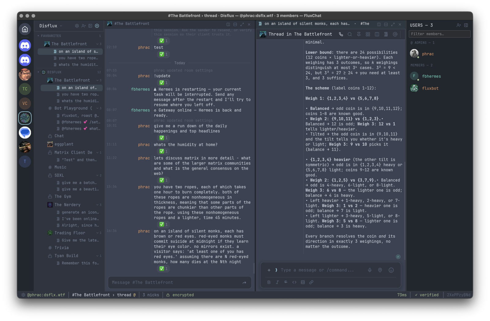
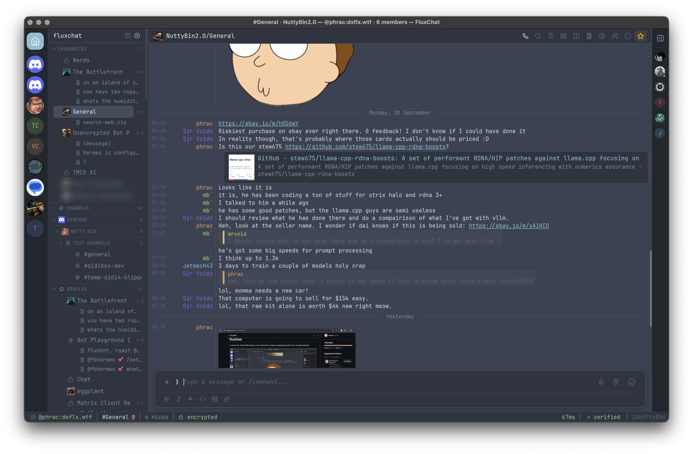
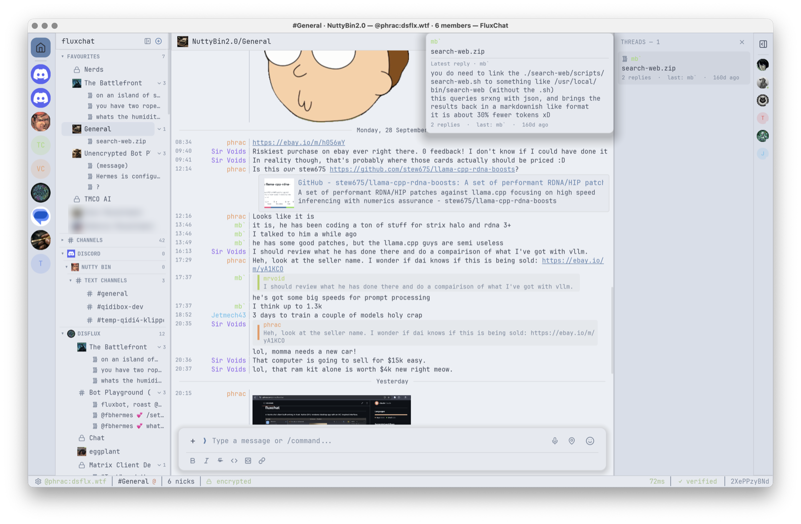
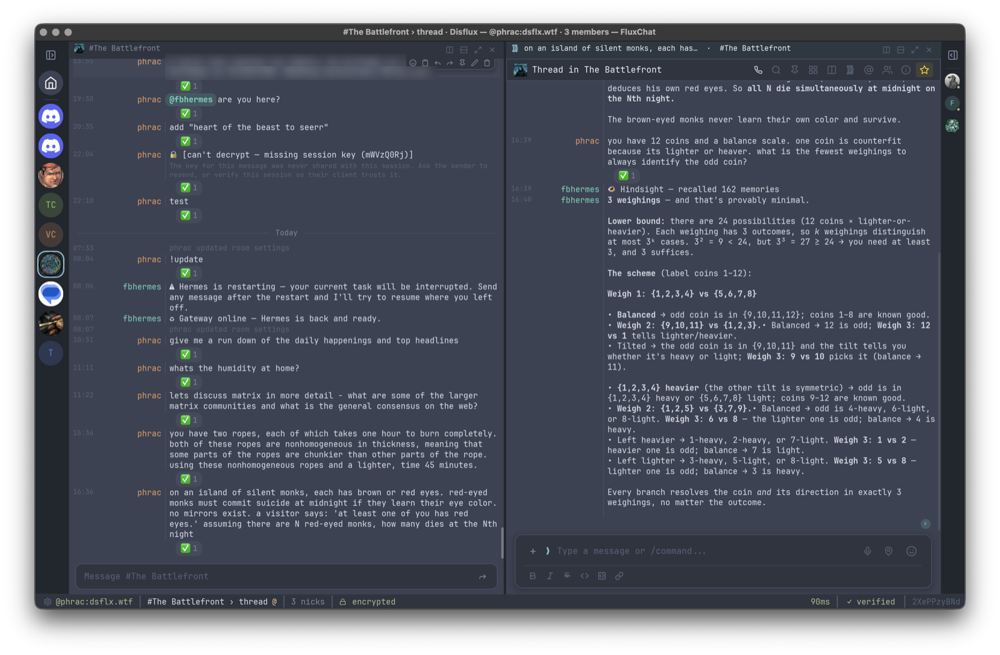
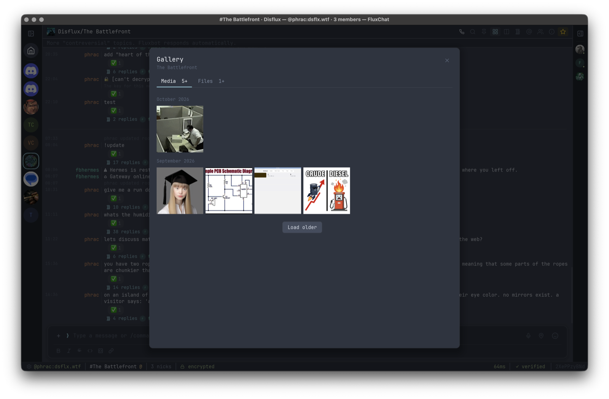
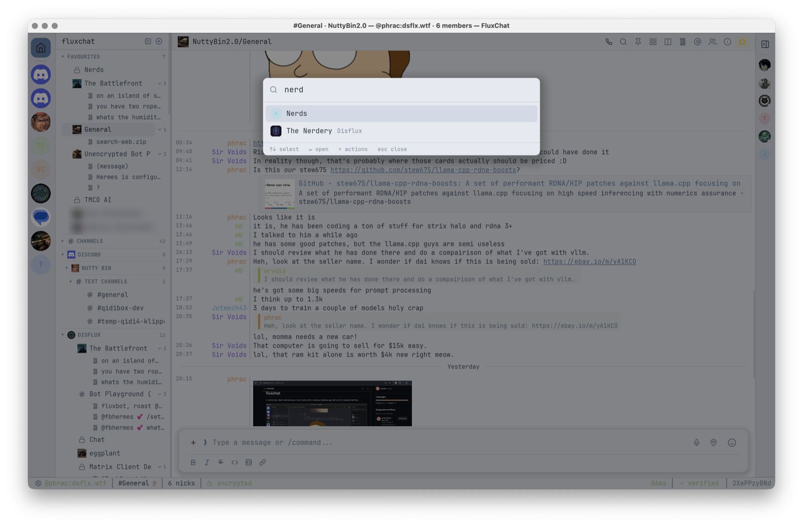
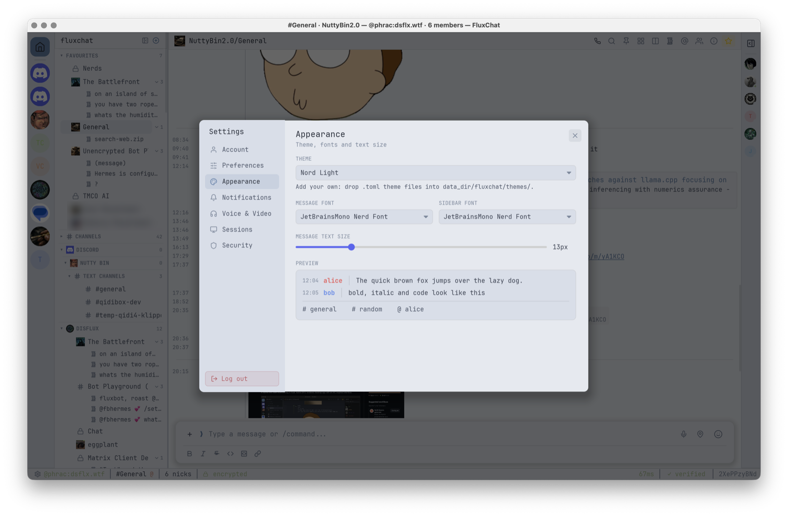

# fluxchat

A fast, native [Matrix](https://matrix.org) chat client written entirely in Rust, with an IRC-inspired interface.



**[Read the user manual →](docs/README.md)**

## Highlights

- **Pure Rust, GPU-rendered.** No Electron, no WebView, no JavaScript. Built on [Iced](https://iced.rs) and [matrix-rust-sdk](https://github.com/matrix-org/matrix-rust-sdk).
- **IRC feel, modern features.** Timestamp, colored nick and message columns in a monospace layout, with images, reactions, threads, spaces, encryption and voice calls.
- **Fast.** Virtualized timeline, sliding sync, lazy-loaded member lists.
- **Your layout.** Split the screen into tmux-style panes and windows; every sidebar opens, closes and resizes independently, and it all comes back after a restart.

## Screenshots

| | | |
|---|---|---|
|  |  |  |
| Timeline: link previews, replies, inline media | Light theme, threads sidebar and hover preview | Panes: a room and its thread side by side |
|  |  |  |
| Gallery of every image, video and file | Command palette (Ctrl/⌘+K) | Themes, fonts and text size |

## Features

### Messaging
- Markdown, code blocks with syntax highlighting, inline LaTeX
- Replies, edits, deletions, reactions, forwarding, pins
- Mentions with autocomplete, `:emoji:` shortcodes, full emoji picker
- Images, video, voice messages, files, GIFs, stickers, polls, locations
- Captions: attach a file and type a message, sent together as one
- Gallery of every image, video and file in a room or thread, back to its first message (encrypted rooms included)
- Link previews, read receipts, typing indicators, per-room drafts
- Rooms open at your first unread message, marked by a NEW line

### Threads
- Threads open in a pane beside the room, with their own reply box; right-click a thread to open it to the right, below, in place or in a new window
- Threads sidebar: every thread in the room, most recently active first
- The three latest threads of each room listed under it in the room list (collapsible); right-click a room for its recent threads
- Hover any thread for the full first message and latest reply
- Reply counts and latest-reply previews under each thread root
- Live updates, including bots that answer inside threads

### Panes & windows
- Split the main area side by side or stacked, as often as you like; put any room or thread in any pane — drag it from the room list onto a pane edge, middle-click / ⌘-click it, or right-click → Open to the right / below / in new window
- Drag to resize and rearrange, zoom a pane to full size
- Multiple windows (layouts), listed in the status bar
- tmux keys: Ctrl+B then `%` `"` `x` `z` `o` arrows `c` `n` `p` `0`–`9` `&`
- Layout saved and restored on restart

### AI agents
- Mark a user as an AI agent (e.g. [Hermes Agent](https://github.com/NousResearch/hermes-agent)): its `/commands` autocomplete and go to it as `!commands`
- Run state on each request and thread (working / needs you / done / failed), with new agent threads opening beside the room as they start
- Run bar with Stop, and Send / Steer / Queue for messages sent while it works
- Approvals and pickers as buttons, with a desktop notification when an agent is waiting on you

### Rooms & spaces
- Room list grouped by space, favourites, unread and mention badges
- Command palette (Ctrl/Cmd+K): jump to rooms or run actions (`>` for actions only)
- Alt+1–9 and Alt+Up/Down room hotkeys
- Space management: browse, join, add, remove and create rooms; edit the space
- Room settings: name, topic, icon, notifications, spaces
- Join requests (ask to join): approve, deny, or deny and ban from a live bar above the room
- Accept or decline all invites at once
- Security & privacy: who can join, history visibility, guests, directory listing, encryption
- Roles & permissions: role per action, privileged users, bans
- Advanced: room version and upgrade, links to replaced/replacing rooms, addresses (main, published, local)
- Bridges tab for bridged rooms: service, network, channel, bot
- Space visibility (private / ask to join / public, directory) and addresses
- Public room directory

### People
- Profile cards with presence, status, roles, verification, and moderation tools
- Member list with filter and presence
- Ignore users (synced to your account, list in Settings), direct messages
- Media previews: always / private rooms only / never, click to show; shared with Element

### Encryption
- End-to-end encryption, emoji (SAS) verification, cross-signing
- Key backup and recovery, session management
- Explanations for messages that can't be decrypted
- Local data encrypted, with the key and sign-in in the system keychain (macOS Keychain, Windows Credential Manager, Secret Service)

### Calls
- Voice calls over MatrixRTC + LiveKit
- Choose microphone and speaker, mic test, echo cancellation, noise suppression

### Notifications
- Desktop notifications driven by your server's push rules
- Account-wide rules: DMs, group rooms, mentions, @room, keywords, invites, calls, bots
- Per-room mode: all messages, mentions only, or mute
- Mentions and keywords highlighted in the timeline
- Mentions inbox (Ctrl/Cmd+I): every message that mentioned you, across all rooms

### Customization
- 9 built-in themes plus your own TOML themes (light and dark)
- Message and sidebar fonts, text size
- Preferences for timestamps (12/24h), compact layout, message grouping, big emoji, link previews, GIF autoplay, send shortcut, markdown, privacy (read receipts, typing, presence)
- Resizable room list, panes and sidebars (pins, threads, mentions, members); hide the room and member lists for more room (Ctrl/Cmd+[ and ])

### Power users
- 57+ slash commands with Tab completion (`/help` lists them)
- `/devtools`: room state inspector and raw event sender
- Password and SSO/OIDC login

## Documentation

The [user manual](docs/README.md) covers everything:

- [Getting started](docs/getting-started.md) · [The interface](docs/interface.md) · [Messaging](docs/messaging.md) · [Threads](docs/threads.md)
- [Panes and windows](docs/panes-and-windows.md) · [Rooms and spaces](docs/rooms-and-spaces.md) · [People](docs/people.md)
- [Notifications](docs/notifications.md) · [Voice and video](docs/calls.md) · [Settings](docs/settings.md) · [Encryption](docs/encryption.md)
- [Keyboard shortcuts](docs/keyboard-shortcuts.md) · [Slash commands](docs/slash-commands.md) · [Themes](docs/themes.md) · [Troubleshooting](docs/troubleshooting.md)

## Building

Requirements: Rust 1.93+, a GPU (wgpu), GStreamer (video). On Linux also libopus and PulseAudio/PipeWire headers (voice).

```bash
# macOS
brew install gstreamer
cargo run -p fluxchat
```

**macOS app bundle**

```bash
scripts/macos-signing-cert.sh   # once: a local code-signing identity
./build-macos.sh
cp -r target/release/FluxChat.app /Applications/
```

macOS ties Keychain access (your saved session) and the microphone permission to the app's signature. The one-time script creates a self-signed "FluxChat Local" identity, which `build-macos.sh` and `cargo run` use when present, so the signature stays the same across rebuilds. Without it builds are signed ad-hoc, and macOS asks again after every rebuild.

**Linux**

```bash
cargo build -p fluxchat --release   # binary: target/release/fluxchat
```

## Architecture

```
crates/
  core/   Matrix logic: timelines, spaces, room admin, push rules, media, audio
  app/    Iced desktop UI (Elm architecture: Message -> update() -> view())
```

| Component | Library |
|-----------|---------|
| UI | Iced 0.14 (wgpu) |
| Matrix | matrix-rust-sdk 0.18, matrix-sdk-ui 0.18 (sliding sync) |
| Encryption | vodozemac |
| Calls | LiveKit 0.7 (MatrixRTC), cpal 0.15 |
| Voice messages | opus + ogg |
| Video | iced_video_player 0.6 (GStreamer) |
| Storage | rusqlite + matrix-sdk SQLite |
| Syntax highlighting | syntect |

## License

MIT
