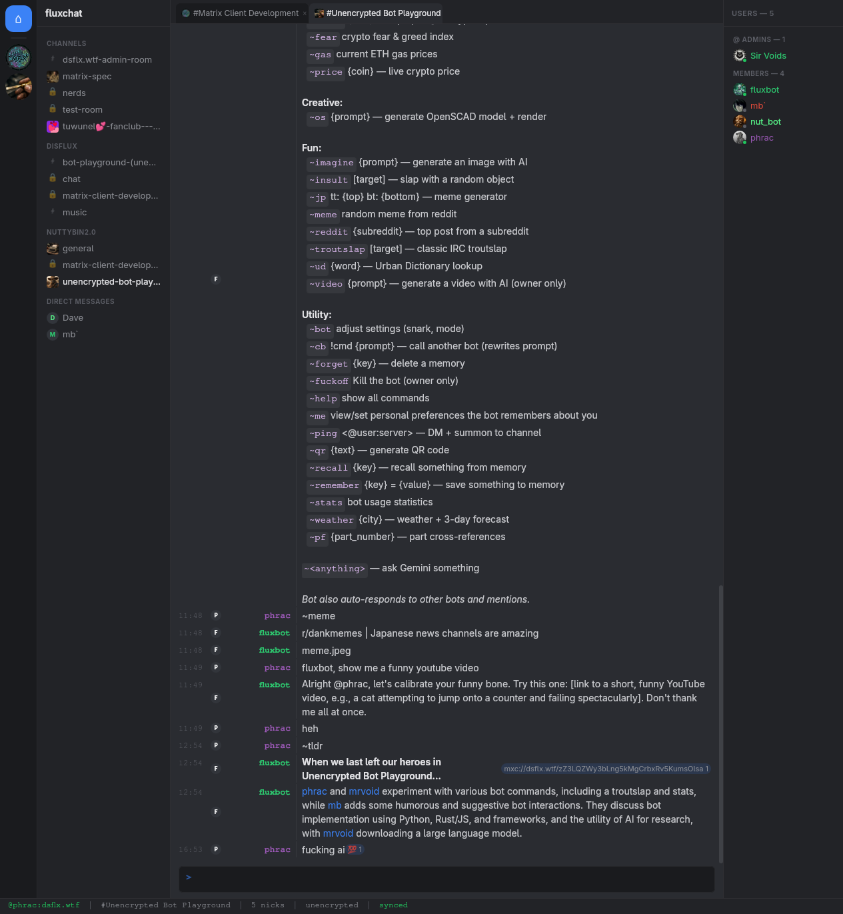

# The interface

## Spaces bar

The narrow column on the far left.

- **Home** shows all your rooms.
- Each **space** you've joined has an icon (its image, or its initials on a coloured tile). Click a space to show only its rooms; the selected space has an accent ring.
- **Right-click** a space for: Manage Space, Invite to Space, Leave Space.

## Room list

- **Header**: the current space's name. When a space is selected, click its name or the ⚙ button to [manage the space](rooms-and-spaces.md#spaces). The **+** button creates a room, space or DM.
- **Sections**: Favourites, rooms grouped by space, Direct Messages, invites. Click a section header to collapse it (remembered).
- **Unread**: a dot plus a count. Red means you were mentioned; accent colour means new messages.
- **Threads under rooms**: each room lists its three most recently active threads, indented. Click one to open it beside the room. The caret and count on the room row collapse or expand them. Hover a thread to preview it.
- **Right-click a room** for:
  - its three most recent threads, plus **All threads**;
  - Mark as Read, Favourite, Copy Link, Open in split view, Invite, Room Settings, Leave.
- **Resize** the room list by dragging its right edge.

## Room header

Across the top of the timeline: room avatar and name, then buttons:

| Button | Does |
|--------|------|
| Phone | Start or join a voice call |
| Search | Search the room's messages |
| Pin | Pinned messages sidebar (red when the room has pins) |
| Split | Split the timeline side by side (see [Panes](panes-and-windows.md)) |
| Spool | Threads sidebar |
| @ | Mentions inbox |
| People | Member list |
| Info | Room settings |
| Star | Favourite |

Below the header, a slim bar shows the room topic.

## Timeline

Messages appear in IRC-style columns: **time | name | message**.

- Consecutive messages from the same person within five minutes are grouped: the name is faded and the avatar is left out. You can turn this off in [Preferences](settings.md#preferences).
- A **NEW** line marks where you stopped reading. Rooms open at that spot when there's something unread.
- **Day dividers** separate days ("Today", "Yesterday", or the date).
- Under a thread's first message, a summary shows the reply count and the latest reply. Click it to open the thread.
- Small avatars under a message show **who has read up to there**. Hover them for names.
- Messages that mention you, @room, or one of your keywords have a soft red background.
- **Hover a message** for actions: react, copy, reply, reply in thread, forward, pin, edit/delete (yours) or report (others').
- **Right-click a message** for: copy link, copy event ID, view source.
- Scroll up to load older history. **PageUp/PageDown** scroll from the message box; **Ctrl+End** jumps to the bottom.
- Click an image to view it large; click it again (or press Esc) to close.

## Sidebars

Four optional panels on the right. Open any combination; each one is resizable and stays open across restarts.

- **Pinned**: the room's pinned messages with who sent them and when. Click one to jump to it; the pin button on a row unpins it.

- **Threads**: every thread in the room, most recently active first. See [Threads](threads.md).
- **Mentions** (**Ctrl/⌘+I**): every message that mentioned you, across all rooms. See [Notifications](notifications.md#mentions-inbox).
- **Users**: the member list with roles, presence dots and a filter box.

## Status bar

Along the bottom:

- **⚙**: opens Settings.
- **Your account and the room**, with your role badge (`@` admin, `+` moderator).
- The member count, and whether the room is encrypted.
- **Windows**: shown when you have more than one, as `0:general* 1:dev`. Click one to switch. `[prefix]` appears after Ctrl+B. See [Panes](panes-and-windows.md).
- Connection: `synced`, the server lag in ms, or `reconnecting…` in red.
- **verified / unverified**: click to open Security settings. "key backup not connected" means old keys are available but not being used; click it.

## Window title

The title shows unread count, room, thread, space, your account and member count, e.g. `(3) #general · MySpace — @me:example.org · 12 members — FluxChat`.

## Command palette

**Ctrl/⌘+K** opens a palette:

- Type a room name to jump to it.
- Matching actions are listed under the rooms: settings tabs, create room, themes, split pane and more.
- Start with `>` to search actions only.
- Use **↑ ↓** to choose, **Enter** to run, **Esc** to close.
